# DESIGN-SPEC — Gill James · gill-sky

Single source of truth for builders. Repo: [jamesgillmedia/gill-sky](https://github.com/jamesgillmedia/gill-sky). Live preview: [jamesgillmedia.github.io/gill-sky/](https://jamesgillmedia.github.io/gill-sky/). Written 10 Nov 2026 (America/Cambridge_Bay, UTC−7). Every URL below was requested this day and returned HTTP 200.

## 1. Purpose and how to use

Base is **u4-opus-m4**: u3's sky, plus in-sky chapter boards, plus the three m3 fixes (whole-word captions and the Just The Beginning credit; ᑕᐣᓯ flies to FAR in one move; boards stop above the mini-map).

Live: https://jamesgillmedia.github.io/gill-sky/u4-opus-m4/  
Code: `u4-opus-m4/` on `main`. Older published m4 can be recovered from git history; do not overwrite other folders to keep a snapshot.

**How to use.** Read this file at the start of every run. Change only what the current fix list names. Anything not listed here: don't change. Test at iPhone size (390×844) first. Motion must be identical with Reduce Motion on (no `prefers-reduced-motion` short-circuit). Real media and copy only; no invented titles, credits or awards.

Related published folders (read-only reference, never edit):

| Lineage | Live URL |
|---|---|
| u3 (sky/chrome source) | https://jamesgillmedia.github.io/gill-sky/u3/ |
| u3-r2 (later u3 fixes) | https://jamesgillmedia.github.io/gill-sky/u3-r2/ |
| u3-r3 (r2 plus sky-label contrast, Demo Reel shot grid, board to the bottom, single arrival name) | https://jamesgillmedia.github.io/gill-sky/u3-r3/ |
| u4-opus-m3 (boards in the sky; 3 later fails fixed in m4) | https://jamesgillmedia.github.io/gill-sky/u4-opus-m3/ |
| u4-opus-m2 (do not copy; see NEVER) | https://jamesgillmedia.github.io/gill-sky/u4-opus-m2/ |

Loved builds live in the **other** repo, [jamesgillmedia/gilljames](https://github.com/jamesgillmedia/gilljames). Import **code only**, no heavy media. Never commit into gilljames.

## 2. KEEP (from u3 / m4)

If any of these regress, revert. Do not redesign them.

**K1. One continuous sky, one camera.** Night water, bloom (0 at FAR, 1 at lv ≥ 1), parallax, fly-through, sketch-3d zoom. No page jump, no overlay that hides the sky.  
Source: u3 / m4 · https://jamesgillmedia.github.io/gill-sky/u4-opus-m4/

**K2. FAR sky.** Five chapters around ᑕᐣᓯ (Film, Photo, Sound, Objects, About), the in-progress cluster, the poem, a single “GILL JAMES” on arrival.  
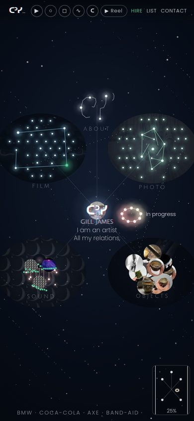  
Source: m4 · https://jamesgillmedia.github.io/gill-sky/u4-opus-m4/?sky=1

**K3. u3 top bar.** Gradient bar (not a solid `#04070b` strip): mark, chapter chips, Reel / List / Contact, ‹. No decorative depth dots. Hire stays in the bar at every sky depth (hidden only on arrival/landings, as in u3).  
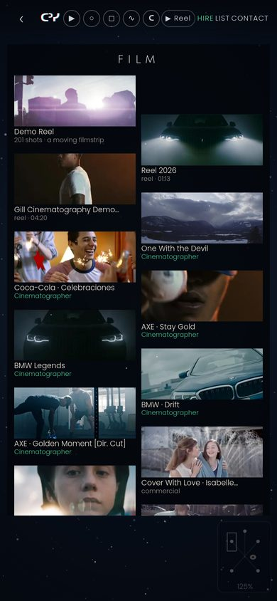  
Source: u3 / m4 · same URL, any level after FAR.

**K4. Level path is one camera tween (~400–600 ms), origin = the touch.**  
- FAR → MID: constellation at u3 fit (`fit.s × 1.45`), never m2's `fit.s × 1.04`. No label collisions; nothing cut off at 390 wide. Outer stars may sit just off-frame; one-finger drift is allowed; no two-finger orbit.  
- MID → BOARD: the same camera pushes in.  
- BOARD → WORK: the work irises out of the tapped tile.  
- OUT: pinch-out, ‹, browser Back and Esc each go up exactly one level and agree. Zoom-out uses `history.back()` / `replaceState`, never a zoom-in `pushState`. No hidden extra inner step.  
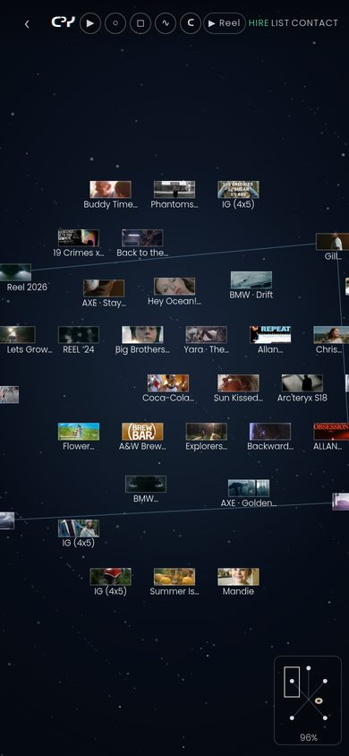  
Source: u3 fit / m4 · https://jamesgillmedia.github.io/gill-sky/u4-opus-m4/?sky=1#film

**K5. Boards are painted in the sky.** A thin ring of night/water stays visible around the grid. No `#board` scrolling overlay, no opaque scrim, no `overflow-y` + `touch-action: pan-y` that blocks pinch.  
  
Source: u3 model, densified in m3/m4 · https://jamesgillmedia.github.io/gill-sky/u4-opus-m4/?sky=1#film/board

**K6. Photo print tilt.** Slight rotation, cream mats/borders, gaps, no overlap. Captions belong to their own print.  
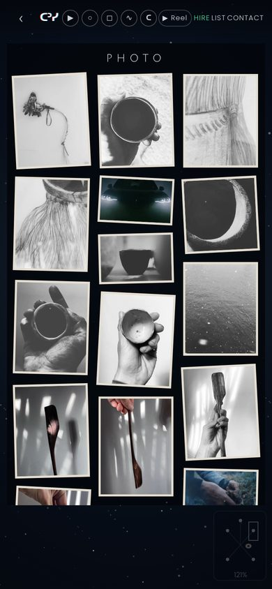  
Source: u3 tilt kept in m4 · https://jamesgillmedia.github.io/gill-sky/u4-opus-m4/?sky=1#photo/board

**K7. Sound is u3's dotted star-chart waveform.** Every peak labelled by song name; lengths in m:ss (e.g. `1:20`, `1:30`, `1:09`). Flag missing cover art as a gap; never reuse the moon-grid still as a cover. No playlist cards, rounded app cards, bar-graph waveform, or play-button rows on the board.  
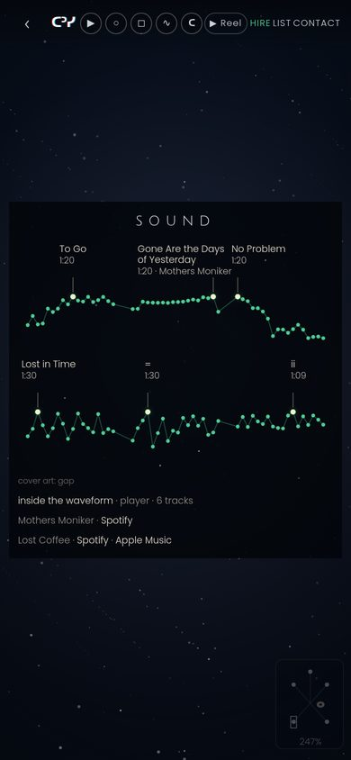  
Source: u3 ported in m4 · https://jamesgillmedia.github.io/gill-sky/u4-opus-m4/?sky=1#sound/board

**K8. Objects: all 14+ pro2 objects plus Spirit Eye, with their own imagery and captions, plus the approved Nov 9 object stills/clips.** Captions sit under/beside their own piece.  
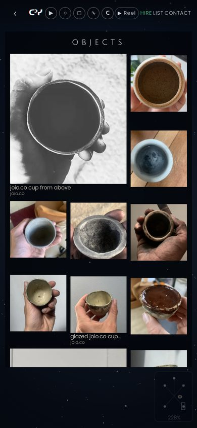  
Source: m4 · https://jamesgillmedia.github.io/gill-sky/u4-opus-m4/?sky=1#objects/board

**K9. Film board language.** 2.39 strips, one column or staggered 2-up, never overlapping. Title + role under their own frame.  
Source: m4 · https://jamesgillmedia.github.io/gill-sky/u4-opus-m4/?sky=1#film/board

**K10. “Just The Beginning” is the film title, credited to Gill James and Ryan.** Not “BONSAI”, never “BONSAI Retail Revolution”. The credit must be visible under the board frame and on the work.  
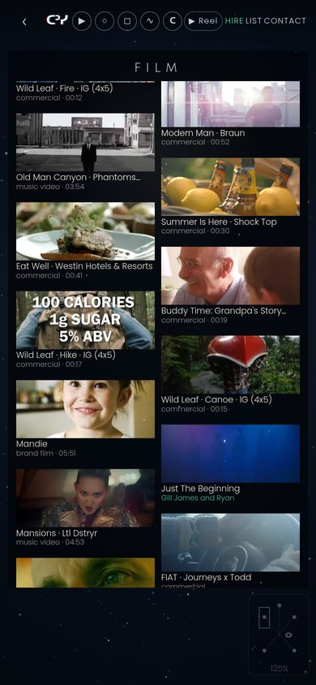  
Source: m4 fix of an m3 fail · same board URL, scrolled to `film/just-the-beginning`

**K11. Captions break only at words.** No letter-spacing that splits “Cinematographer” or “commercial”. “Demo Reel” must never read “Dem o Reel”.  
Source: m4 fix · visible on [spec-img/k-jtb-credit.jpg](spec-img/k-jtb-credit.jpg) and [spec-img/k-board-film.jpg](spec-img/k-board-film.jpg)

**K12. Tapping the ᑕᐣᓯ mark flies to FAR in one move from any level** (not one history step). Pinch-out / ‹ / Esc / Back still walk one level. The mark is shown beside ‹ at deep levels.  
Source: m4 fix of an m3 fail · m4 `PROGRESS.md`

**K13. Mini-map is present and clear of tiles.** It must not cover a film still, print, object, waveform or bio text. Fade or park it; fade alone is not enough if it still sits on a tile.  
Source: m4 fix of C4 · check [spec-img/k-board-photo.jpg](spec-img/k-board-photo.jpg) and boards above

**K14. WORK first frame is a real still/poster**, never a black or muddy field (u3 C2 / Demo Reel). Further pinches deepen frames, cut-outs or the waveform as in u3.  
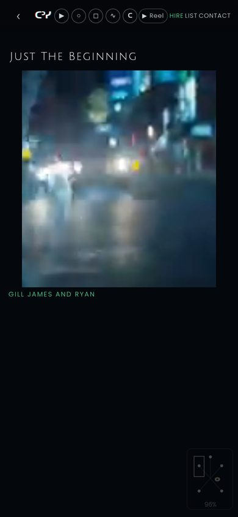  
Also: [spec-img/k-work-reel.jpg](spec-img/k-work-reel.jpg) · https://jamesgillmedia.github.io/gill-sky/u4-opus-m4/?sky=1#film/just-the-beginning and `#film/demo-reel`

**K15. About is text-led; Vancouver only; no “he/him” badge; calculator one level below the board.** Public bio stays the verbatim third-person text already on the site. Never write “award-winning”. Spirit Eye wording stays exactly: “recognized with Best Public Art Concept and Council's Choice within the BIDC Public Art Intensive”, co-created with Joshua Ngenda.  
Source: u3 / m4 / u4-opus-context.md

**K16. Reduce Motion is identical motion.** No `prefers-reduced-motion` branch that cuts the fly-through.  
Source: u3 / RULEBOOK / m4

**K17. No YouTube links or YouTube UI.** Songs already list Spotify / Apple Music / Mothers Moniker / Lost Coffee as plain text under the chart.  
Source: standing rule · [spec-img/k-board-sound.jpg](spec-img/k-board-sound.jpg)

**K18. Installable folder app.** Own `manifest.webmanifest`, service-worker scope and cache name (scoped to `u4-opus-m4/`). Works offline once visited; full-screen standalone; safe areas respected. Files under 25 MB. A JS-off list page must still work.  
Source: u4-opus-context.md / m4 checklist

**K19. Hash / popstate on a booted page must honour the hash** (u3 C1). A deep link such as `#photo/board` opens that board, not FAR.  
Source: m2-ported fix, kept in m4

**K20. Nov 9 media already on m4** (`media/nov9/`, `js/nov9.js`): 63 object files as tiles (named ones after the matching pro2 object; 15 “unknown” uncaptioned at the end); 16 film stills uncaptioned at the end of Film; 17 photo stills at the end of Photo. The 2 “other” files are unused (see Open questions). Do not add the excluded or held files in §4.

## 3. BRING BACK (from loved builds, into u3's sky)

**Decision record (Gill, Nov 10, 2026, 8:45 PM MST, by voice):** B1 YES · B2 YES · B3 YES · B4 YES · B5 YES. All five are approved and in scope for the merge run.

Adapt these into the current m4 camera and chrome. Do **not** redesign u3's FAR, top bar, or motion to match those older shells. Do not bring back pro2's list-as-home, second `#sky` sheet, or dock / mint tabs.

**B1. pro2 board density — named stills grid.** **Gill: YES (Nov 10).** Take the L2 density: a tight grid of named stills you can actually read, sky still felt behind. Apply it by deepening the in-sky m4 board (K5/K9), without m2 overlaps or pro2's dock.  
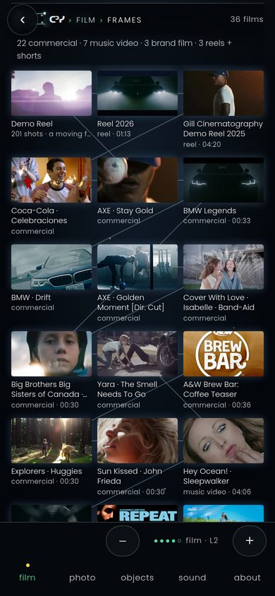  
Code (gilljames): `site-v3-pro2/` — especially `js/pro.js`, `css/pro.css`, `css/v3.css`, chapter folders `film/`, `photo/`, `objects/`.  
Live: https://jamesgillmedia.github.io/gilljames/site-v3-pro2/ (L2: `#film/l2`)

**B2. pro3 tappable breadcrumb + depth rail — Gill: YES (Nov 10).** Add it beside the u3 bar; do not remove the bar. Take: a single source of truth for the level; tappable crumb segments (real names, e.g. sky · film · board · work); tapping ᑕᐣᓯ still flies to FAR (K12); a true depth rail whose stops equal real levels, not decorative dots. Do **not** replace the u3 gradient bar, chips, or Reel/List/Contact unless Gill says to. Do **not** copy pro3's “BONSAI · Just The Beginning” constellation label (visible on the live pro3 film sky).  
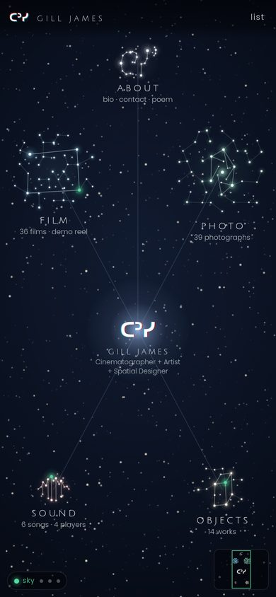  
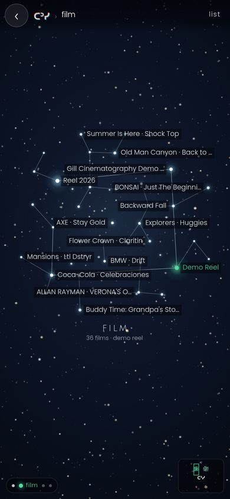  
Code (gilljames): `site-v3-pro3/js/world.js` (breadcrumb + rail follow `cur`); `site-v3-pro3/css/world.css` (`.wr` depth rail, `.wmm` mini-map); `site-v3-pro3/css/v3.css` (`.crumb`). The w7 world is `site-v3-pro3/w7/`. w8 is live at `site-v3-pro3/w8/` (200 on 10 Nov 2026).  
Live: https://jamesgillmedia.github.io/gilljames/site-v3-pro3/ · w7: https://jamesgillmedia.github.io/gilljames/site-v3-pro3/w7/ · w8: https://jamesgillmedia.github.io/gilljames/site-v3-pro3/w8/

**B3. pro2 drifting 201-shot filmstrip reel.** **Gill: YES (Nov 10).** Take the Scope / filmstrip player: 201 distinct reel shots in order (`GJ_REEL` in `reelshots.js`), swipe-to-flip strip, shot counter (`REEL 001 / 201`), local files under `reel/`. Render it as a WORK-level camera stop inside the m4 sky (Demo Reel already says “201 shots · a moving filmstrip” on the m4 board), not as a black fade overlay or a YouTube embed.  
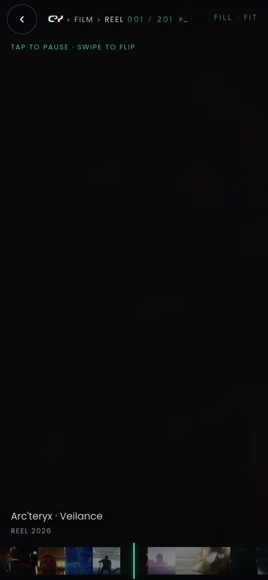  
Code (gilljames): `site-v3-pro2/js/reelshots.js`, `site-v3-pro2/js/scope.js`, `site-v3-pro2/css/reel.css`, `site-v3-pro2/reel/`. (The same 201-entry `reelshots.js` also exists under `site-v3-pro3/`.)  
Live: https://jamesgillmedia.github.io/gilljames/site-v3-pro2/#reel

**B4. sketch-3d boards-in-world feel.** **Gill: YES (Nov 10).** Take: boards that live in the 3D/sky world (a ring of night around a readable grid), free pinch zoom and drag, a where-am-I label, and the ᑕᐣᓯ / pull-back home mark. Land on a board by flying the same camera, not by opening a new page. Prefer `sketch-3d-c` for the in-world board; `sketch-3d` for the free-zoom sky.  
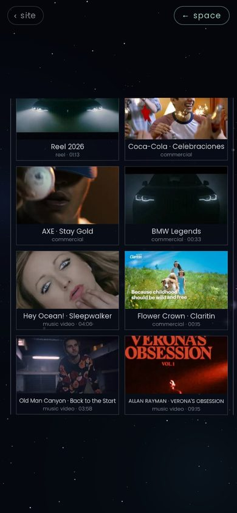  
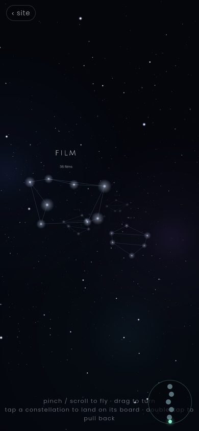  
Code (gilljames): `sketch-3d/` (`index.html`, `main.js`) and `sketch-3d-c/` (`index.html`, `main.js`).  
Live: https://jamesgillmedia.github.io/gilljames/sketch-3d/ · https://jamesgillmedia.github.io/gilljames/sketch-3d-c/

**B5. sound-sketch stars-as-songs.** **Gill: YES (Nov 10).** Take: each song is a star you can tap; pinch zooms in; the player / waveform is the deepest level (“inside the sound”), one tap from the Sound constellation, in the same sky. Keep m4's dotted labelled chart (K7) as the board; do not swap it for the sketch's rounded song pills or a “DIVE IN” splash if that fights K7. Wind-chime zoom (historical favourite, commit `4ce0365` in gilljames) is the motion reference, not a second player.  
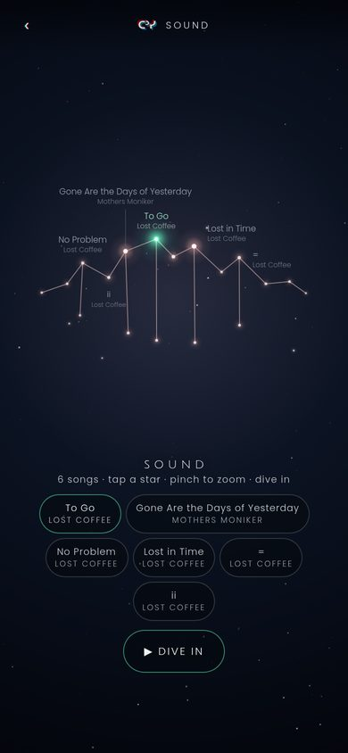  
Code (gilljames): `sound-sketch/js/player.js`, `sound-sketch/js/tracks.js`, `sound-sketch/css/`, `sound-sketch/index.html`.  
Live: https://jamesgillmedia.github.io/gilljames/sound-sketch/

## 4. NEVER

**N1. m2 board as a scrolling overlay outside the camera.** No `#board` at `z-index: 6` with `overflow-y: auto` and `touch-action: pan-y`. No opaque night scrim. The camera must still move.  
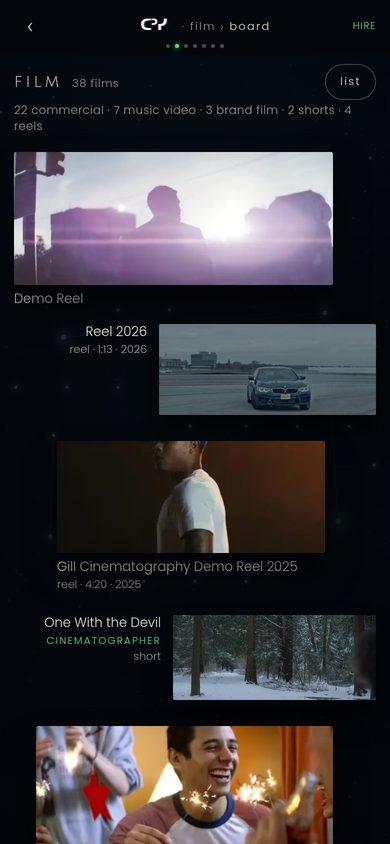  
Source: u4-opus-m2 · https://jamesgillmedia.github.io/gill-sky/u4-opus-m2/?sky=1#film/board

**N2. m2 crammed constellation.** No `fit.s × 1.04` packing, colliding titles, or thumbs hanging off both edges (m2 Film mid sat at ~69%).  
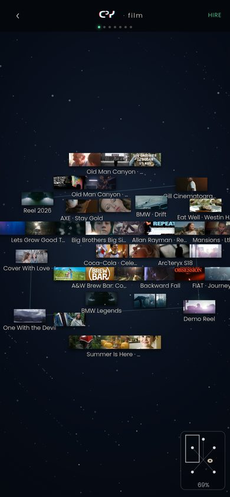  
Source: same build · https://jamesgillmedia.github.io/gill-sky/u4-opus-m2/?sky=1#film

**N3. Solid header strip and fake depth dots.** No `#bar.deep` with `background: #04070b`, no mint 7- or 10-dot rail that does not equal real levels, no crumb that eats the mark and hides Reel/List/Contact.  
Source: m2 mid/board shots above

**N4. Do not redesign u3 chrome** (FAR layout, gradient bar, chips, typography, water, bloom choreography) to look like pro2's dock, m2's deep bar, or a new visual language.

**N5. Do not overwrite other folders** in gill-sky (`u1`, `u2`, `u3`, `u3-r2`, `u3-r3`, `u3-preview`, `u4-opus-m1`–`m3`, `r4`–`r11`, `media/` at repo root, etc.). Saves for this line go only to `u4-opus-m4/`.

**N6. Do not change the gill-sky root redirect.** The root (`https://jamesgillmedia.github.io/gill-sky/`) currently meta-refreshes to `r9/`. Leave it.

**N7. Do not touch the gilljames repo.** Reference-copy code into gill-sky only.

**N8. Private photos — hard ban, never use:** `IMG_1936`, `IMG_1188`, `IMG_1189`, `IMG_6405`, `IMG_6606`, `IMG_6612`, `22179A95`.

**N9. Hold pending Gill (do not publish):** `IMG_5722`, `IMG_1187`, `IMG_6881`. A standing rule once allowed these three family photos with no names or captions; the Nov 9 pack held them. Wait for Gill.

**N10. Also held from the Nov 9 pack (30 items total, including N9).** Do not add until Gill says so:  
`63754481495__B826C373-B26F-4204-B895-7ECF09E3C9BD`, `E9A51F6C-43C3-4224-AA47-ED5FEBF420B6`, `IMG_0844`, `IMG_2013`, `IMG_3450`, `IMG_1136`, `IMG_1138`, `IMG_1144`, `IMG_1924`, `IMG_2943`, `IMG_5510`, `IMG_6315`, `IMG_6319`, `IMG_6320`, `IMG_5002`, `IMG_5004`, `IMG_9316`, `IMG_5910`, `IMG_9415`, `IMG_5950`, `IMG_6625`, `IMG_6626`, `IMG_6634`, `IMG_6635`, `IMG_9720`, `1C59016F-433B-4E75-AD2E-F8A43BF23F34`, `63356826146__A528E774-004C-4E3D-B6AC-50D415296ED1`.  
Source: `/workspace/nov9-media/summary.json` (and `web/manifest.json`).

**N11. Never use any part of `vidA.mp4` after 9 seconds.**

**N12. Never write “award-winning”.** Never put “he/him” or Two-Spirit in the public bio.

**N13. No YouTube** (links, embeds, or UI).

**N14. No rounded playlist cards, “list” pills on boards, or generic bar-graph waveforms** (m2 Sound). No inventing copy, credits, or awards.

## 5. Process

**P1. Live-preview rule (overrides earlier “new folder / don't publish” notes in `u4-opus-m4/PROGRESS.md`).** Every save goes straight to `main` inside `u4-opus-m4/` only. The URL https://jamesgillmedia.github.io/gill-sky/u4-opus-m4/ updates after Pages deploy (recent deploys were about 45 seconds to 2 minutes). Do not gate Gill's preview on a review pass. Checks may run alongside as notes.

**P2. Commit and push after every small step**, so a run that hits a usage limit can resume.

**P3. Keep `_progress/PROGRESS.md` current** (checkpoint a fresh run can read). Record what changed, hashes to test, and anything still open.

**P4. Check only the files and views that changed.** No full ~2,000-URL re-verify after every save. Self-check the touched levels at 390×844.

**P5. Fix lists are exact:** name the file, the line or tile, and the pass condition. Change nothing else.

**P6. This spec wins** if it conflicts with an older RULEBOOK, brief, or `PROGRESS.md` process line (especially publish-to-a-new-folder, or “work on branch `cursor/u4-opus-5d75` only”).

## 6. Open questions for Gill

Do not invent answers. Leave these until he decides.

1. ~~Breadcrumb vs u3 top bar (B2).~~ Resolved Nov 10: Gill said yes to B2. Add the crumb and rail beside the u3 bar (K3), and keep the bar.
2. **Client line.** Stay “BMW · Coca-Cola · AXE · Band-Aid”, or put Arc'teryx in place of Band-Aid?
3. **Family stills `IMG_5722`, `IMG_1187`, `IMG_6881`.** Publish with no names/captions, or keep holding?
4. **The other 27 held Nov 9 items** (household, informal selfies, documents, screenshots). Stay held?
5. **The two unused Nov 9 “other” files** (orange graphic with the email; handwritten Lost Coffee lettering). Use them, or leave them out?
6. **Song cover art** is still a labelled gap on the m4 Sound board. Supply art, or leave the gap flag?
7. **JS-off list pages** do not yet include Nov 9 media (noted in m4 `PROGRESS.md`). Should the merge run fix that?
8. **Bio running copy** still uses “he” / “His” / “He's” (same as u3). Only the “he/him” badge is banned. Leave the verbatim bio as-is?
9. **w8** is live at https://jamesgillmedia.github.io/gilljames/site-v3-pro3/w8/. Is it a reference to merge from, or leave it in gilljames only?
10. **Frozen m4 snapshot.** Git history already has the published m4. Does Gill also want a separate compare folder, or is history enough?
11. If m4 navigation still feels wrong after this spec, a screen recording of the fail will pin the next fix list.
